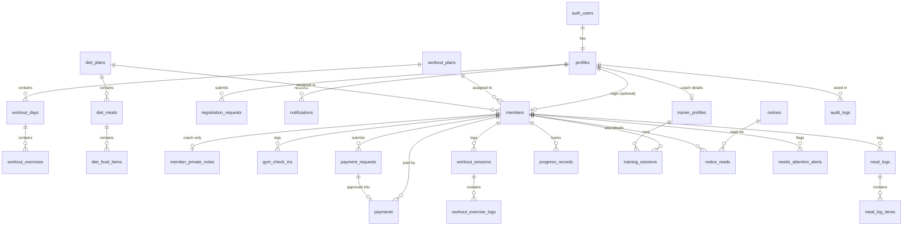

# Database Architecture (Supabase)

Replaces the browser `localStorage` layer in `src/services/storage.ts` with Postgres, Supabase Auth and Supabase Storage. The SQL is in `supabase/migrations/`, and it assumes one gym with one or more coaches who all see every member.

| Migration | Contents |
|---|---|
| `..._schema.sql` | 21 enums, 25 tables, indexes, the `member_overview` view |
| `..._functions.sql` | Helpers, triggers, RPC functions |
| `..._security.sql` | Grants, row-level security (RLS) policies, Realtime |
| `..._storage.sql` | Photo buckets and their policies |

## Setup

1. Create a Supabase project. In **Authentication > Sign In / Providers > Email**, turn off **Confirm email**. Registration needs a session straight after sign-up to upload the photo and file the request, and the coach reviews every applicant anyway.
2. Open the **SQL Editor** and run the four migration files in filename order.
3. Create the coach's login in **Authentication > Users**, then run:

```sql
update public.profiles set role = 'trainer'
where id = (select id from auth.users where email = 'COACH_EMAIL');

insert into public.trainer_profiles (user_id, full_name, gym_name, title, email)
select id, 'Coach Oliul Azim', 'Azim''s Workout Arena & Performance Club',
       'CSCS & Head Performance Coach', email
from auth.users where email = 'COACH_EMAIL';
```

This is the only way to create a coach. Roles are never taken from sign-up data.

## Tables and relationships



| Group | Tables |
|---|---|
| Identity | `profiles`, `trainer_profiles` |
| Members | `members`, `member_private_notes`, `gym_check_ins` |
| Plans | `workout_plans`, `workout_days`, `workout_exercises`, `diet_plans`, `diet_meals`, `diet_food_items` |
| Money and joining | `payment_requests`, `payments`, `registration_requests` |
| Activity | `workout_sessions`, `workout_exercise_logs`, `meal_logs`, `meal_log_items`, `progress_records`, `training_sessions` |
| Communication | `notices`, `notice_reads`, `notifications`, `needs_attention_alerts`, `audit_logs` |

Deleting a member removes their activity, but `payments` rows stay with `member_id` null and the `member_name` snapshot intact, so financial history remains complete.

## Who can do what

| Data | Coach | Member | Applicant (signed up, not approved) | Not signed in |
|---|---|---|---|---|
| Members, payments, sessions, logs | Everything | Read own | None | None |
| Private coach notes | Everything | None | None | None |
| Plan name and summary | Everything | Read if assigned | None | None |
| Plan days, exercises, meals, foods | Everything | Read if assigned **and** paid up | None | None |
| Workout, meal and progress logs | Review | Submit own, cannot pre-approve | None | None |
| Payment requests | Approve or reject | Submit own | None | None |
| Registration requests | Approve or reject | Read own | Submit and read own | None |
| Gym check-ins | Everything | Add or remove own | None | None |
| Notices | Everything | Read if targeted | None | None |
| Notifications | Own, mark read | Own, mark read | Own, mark read | None |
| Audit log | Read only | None | None | None |

"Paid up" means the package is fully paid, or a completed payment exists for the current Dhaka calendar month.

## Business rules in the database

**Computed by the `member_overview` view.** Read members from this view rather than from `members`. It adds `amount_paid`, `balance_due`, `payment_status` and the live `status`.

**Automatic, via triggers.** Notifications and audit entries for every event the app logs today, `current_weight_kg` after a progress record, `remaining_sessions` on attendance changes, and a `profiles` row for each new login.

**Called by the app with `supabase.rpc(...)`**

| Function | Purpose |
|---|---|
| `approve_payment_request(id)` | Records the payment and moves the deadline to the 10th of next month |
| `reject_payment_request(id, reason)` | Declines and notifies the member |
| `approve_registration_request(id, price, sessions, workout_plan, diet_plan)` | Creates the member. Last four arguments are optional (defaults: ৳3500, 12 sessions, no plans) |
| `reject_registration_request(id, reason)` | Declines the application |
| `save_workout_plan(plan)` / `save_diet_plan(plan)` | Saves a whole nested plan in one transaction. Accepts the existing `WorkoutPlan` / `DietPlan` JSON shape |
| `current_member_is_unlocked()` | Replaces `isMemberWorkoutDietUnlocked` for the locked screen |

## Photos

| Bucket | Access | Limit | Stored in |
|---|---|---|---|
| `avatars` | Public URL | 2 MB | `avatar_url`, `front_photo_url` |
| `meal-photos` | Private: owner and coach | 5 MB | `meal_logs.photo_path` |
| `progress-photos` | Private: owner and coach | 5 MB | `progress_records.photo_path` |

Upload to `<user id>/<random name>.jpg`. Random names matter for `avatars`, where anyone with the URL can view the image. Private photos are shown with `createSignedUrl(path, ...)`. A coach uploading a photo for a member may use their own folder.

## Differences from the current app types

| App (`src/types/index.ts`) | Database |
|---|---|
| IDs such as `mem-01` | UUIDs generated by the database |
| camelCase fields | snake_case columns |
| `Member.status`, `paymentStatus`, `amountPaid` | Computed in `member_overview`. The stored field is `base_status` (`Active` or `Inactive`) |
| `Member.trainerPrivateNotes` | `member_private_notes` table, so members cannot read it |
| `Member.temporaryPassword`, `MemberRegistrationRequest.password` | Removed. Passwords exist only in Supabase Auth |
| `Member.gymCheckInDates[]` | `gym_check_ins` rows |
| `Plan.assignedMemberIds[]` | Derived from `members.assigned_workout_plan_id` / `assigned_diet_plan_id` |
| `Notice.readByMemberIds[]` | `notice_reads` rows |
| `memberName`, `memberAvatar` on child records | Read through a join. `payments.member_name` is kept as a snapshot |
| `MealLog.photoUrl`, `ProgressRecord.photoUrl` | `photo_path`, a storage path |
| `personalBests` object | Four columns on `progress_records` |
| `MealLog.date`, `ProgressRecord.date`, `PaymentRecord.date` | `log_date`, `record_date`, `payment_date` |
| `AuditLogItem.timestamp` | `occurred_at` |

## Account flows

**Self-registration.** `supabase.auth.signUp` → upload photo to `avatars` → insert into `registration_requests` with `user_id` set to the new user → coach calls `approve_registration_request`, which links the login to the new member.

**Coach enrolment (`AddMemberModal`).** Coach inserts into `members` with `user_id` null and `activation_status` `'Invited'`. Sending the invitation needs a small Edge Function, because it requires the service-role key, which must never reach the browser: call `auth.admin.inviteUserByEmail`, then set `members.user_id` to the returned user's id.

## Known limits

- `needs_attention_alerts` has only seed data in the app today. Nothing generates alerts yet, so the table stays empty until a job or trigger is added.
- A workout or meal log and its child rows are two separate inserts. If the second fails, the parent record exists without its items.
- Supporting multiple independent gyms would require a `gym_id` on most tables and changes to every policy.
