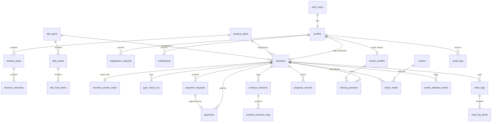

# Database Architecture (Supabase)

The app reads and writes all data in Supabase: Postgres for data, Supabase Auth for accounts (email and Google), Supabase Storage for photos, Realtime for live updates, and an Edge Function for push notifications. The SQL is in `supabase/migrations/`. It assumes one gym, with one or more coaches who all see every client.

| Migration | Contents |
|---|---|
| `20261109100000_schema.sql` | Enums, tables, indexes, the `member_overview` view |
| `20261109100100_functions.sql` | Helpers, triggers, RPC functions |
| `20261109100200_security.sql` | Grants, row-level security (RLS) policies, Realtime |
| `20261109100300_storage.sql` | Photo buckets and their policies |
| `20261110100000_super_admin_role.sql` | Adds the `super_admin` role (must run on its own) |
| `20261110100100_production_features.sql` | Super admin, Google account linking, coach/client notifications, client updates, push, live updates for all tables |

## Setup

Do these in order. Steps 1–4 are required; 5–7 enable push notifications and client invitations.

### 1. Database
In the **SQL Editor**, run each migration file **separately**, in filename order. File 5 must finish before file 6 starts, because Postgres cannot use a new role value in the same run that creates it.

### 2. Authentication
- **Authentication > Sign In / Providers > Email**: turn off **Confirm email**. Email registration needs a session immediately to upload the photo and submit the application, and the coach approves every applicant anyway.
- **Authentication > Sign In / Providers > Google**: enable it and paste a Google OAuth Client ID and Secret. Create these in Google Cloud Console under **APIs & Services > Credentials > OAuth client ID (Web application)**. Under **Authorized redirect URIs** add `https://YOUR-PROJECT.supabase.co/auth/v1/callback`.
- **Authentication > URL Configuration**: set **Site URL** to your live app address and add it, plus `http://localhost:3000`, to **Redirect URLs**.

### 3. App environment
Set `VITE_SUPABASE_URL` and `VITE_SUPABASE_ANON_KEY` (see `.env.example`) in `.env.local` and in your hosting provider.

### 4. Super admin and coach photo
1. Open the app and choose **Continue with Google** with `oliulazim65@gmail.com`. The account becomes **Super Admin** automatically, with username `oliulazim65` and the main coach profile. The grant only applies to a Google sign-in, because Google proves the address belongs to its owner; an email and password sign-up with that address stays a normal client account.
   - To use email and password instead, create the account, then run `select public.grant_role_by_email('oliulazim65@gmail.com');` in the SQL Editor.
2. Upload the coach photo to Storage. Either sign in as the coach and use **Settings > Change photo**, or run once from the project folder:
   ```
   SUPABASE_URL=https://YOUR-PROJECT.supabase.co SUPABASE_SERVICE_ROLE_KEY=... node scripts/upload-coach-photo.mjs
   ```
   This uploads `supabase/seed/coach-oliul-azim.jpg` to the public `avatars` bucket and saves its permanent URL on the main coach profile, which every client sees.
3. In **Settings**, add the bKash number clients should pay to.

### 5. Push notifications
1. Generate a VAPID key pair once: `npx web-push generate-vapid-keys`.
2. Put the public key in `VITE_VAPID_PUBLIC_KEY`.
3. Deploy the functions: `npx supabase functions deploy send-push --no-verify-jwt` and `npx supabase functions deploy invite-member`. You can also paste each `index.ts` into **Edge Functions > Deploy a new function** in the dashboard.
4. Set the function secrets in **Edge Functions > Secrets**: `VAPID_PUBLIC_KEY`, `VAPID_PRIVATE_KEY`, `VAPID_SUBJECT` (e.g. `mailto:oliulazim65@gmail.com`), `PUSH_WEBHOOK_SECRET` (any long random string), and `SITE_URL` (your app address).
5. Tell the database where to send pushes, in the SQL Editor:
   ```sql
   select vault.create_secret('https://YOUR-PROJECT.supabase.co/functions/v1/send-push', 'push_function_url');
   select vault.create_secret('THE-SAME-PUSH_WEBHOOK_SECRET', 'push_webhook_secret');
   ```
   Until these exist, notifications still appear in the app; only the push to the device is skipped.
6. Each person turns notifications on for their device in **Settings**. On iPhone, the app must first be added to the Home Screen (iOS 16.4 or later).

### 6. Client invitations
The `invite-member` function (deployed in step 5) emails a coach-enrolled client a sign-in link and links the new login to their record. A client whose record the coach created can also simply choose **Continue with Google** with the same email; they are linked automatically.

### 7. Hosting
Deploy the built app (`npm run build`, output in `dist/`) to any static host, such as Vercel, Netlify or Cloudflare Pages, over HTTPS. Push notifications require HTTPS.

## Roles

| Role | How it is assigned | Access |
|---|---|---|
| Super Admin | `role_grants` table, on first Google sign-in (seeded with `oliulazim65@gmail.com`) | Everything a coach can do, plus changing roles and the main coach |
| Coach | Super Admin, in **Manage Coaches & Roles** | All clients, plans, payments, notices, reports |
| Client | Approved registration, or a coach-created record linked by invite or Google | Their own data only |

All of this is enforced by database policies and `security definer` functions. The app hides screens by role, but hiding is never the protection.

## Tables and relationships



| Group | Tables |
|---|---|
| Identity | `profiles`, `trainer_profiles` |
| Members | `members`, `member_private_notes`, `gym_check_ins` |
| Plans | `workout_plans`, `workout_days`, `workout_exercises`, `diet_plans`, `diet_meals`, `diet_food_items` |
| Money and joining | `payment_requests`, `payments`, `registration_requests` |
| Activity | `workout_sessions`, `workout_exercise_logs`, `meal_logs`, `meal_log_items`, `progress_records`, `training_sessions` |
| Communication | `notices`, `notice_reads`, `notifications`, `needs_attention_alerts`, `audit_logs` |

Deleting a member removes their activity, but `payments` rows stay with `member_id` null and the `member_name` snapshot intact, so financial history remains complete.

## Who can do what

| Data | Coach | Member | Applicant (signed up, not approved) | Not signed in |
|---|---|---|---|---|
| Members, payments, sessions, logs | Everything | Read own | None | None |
| Private coach notes | Everything | None | None | None |
| Plan name and summary | Everything | Read if assigned | None | None |
| Plan days, exercises, meals, foods | Everything | Read if assigned **and** paid up | None | None |
| Workout, meal and progress logs | Review | Submit own, cannot pre-approve | None | None |
| Payment requests | Approve or reject | Submit own | None | None |
| Registration requests | Approve or reject | Read own | Submit and read own | None |
| Gym check-ins | Everything | Add or remove own | None | None |
| Notices | Everything | Read if targeted | None | None |
| Notifications | Own, mark read | Own, mark read | Own, mark read | None |
| Audit log | Read only | None | None | None |

"Paid up" means the package is fully paid, or a completed payment exists for the current Dhaka calendar month.

## Business rules in the database

**Computed by the `member_overview` view.** Read members from this view rather than from `members`. It adds `amount_paid`, `balance_due`, `payment_status` and the live `status`.

**Automatic, via triggers.** Notifications and audit entries for every event the app logs today, `current_weight_kg` after a progress record, `remaining_sessions` on attendance changes, and a `profiles` row for each new login.

**Called by the app with `supabase.rpc(...)`**

| Function | Purpose |
|---|---|
| `approve_payment_request(id)` | Records the payment and moves the deadline to the 10th of next month |
| `reject_payment_request(id, reason)` | Declines and notifies the member |
| `approve_registration_request(id, price, sessions, workout_plan, diet_plan)` | Creates the member. Last four arguments are optional (defaults: ৳3500, 12 sessions, no plans) |
| `reject_registration_request(id, reason)` | Declines the application |
| `save_workout_plan(plan)` / `save_diet_plan(plan)` | Saves a whole nested plan in one transaction. Accepts the existing `WorkoutPlan` / `DietPlan` JSON shape |
| `current_member_is_unlocked()` | Replaces `isMemberWorkoutDietUnlocked` for the locked screen |

## Photos

| Bucket | Access | Limit | Stored in |
|---|---|---|---|
| `avatars` | Public URL | 2 MB | `avatar_url`, `front_photo_url` |
| `meal-photos` | Private: owner and coach | 5 MB | `meal_logs.photo_path` |
| `progress-photos` | Private: owner and coach | 5 MB | `progress_records.photo_path` |
| `update-photos` | Private: owner and coach | 5 MB | `member_updates.photo_path` |

Upload to `<user id>/<random name>.jpg`. Random names matter for `avatars`, where anyone with the URL can view the image. Private photos are shown with `createSignedUrl(path, ...)`. A coach uploading a photo for a member may use their own folder.

## Differences from the current app types

| App (`src/types/index.ts`) | Database |
|---|---|
| IDs such as `mem-01` | UUIDs generated by the database |
| camelCase fields | snake_case columns |
| `Member.status`, `paymentStatus`, `amountPaid` | Computed in `member_overview`. The stored field is `base_status` (`Active` or `Inactive`) |
| `Member.trainerPrivateNotes` | `member_private_notes` table, so members cannot read it |
| `Member.temporaryPassword`, `MemberRegistrationRequest.password` | Removed. Passwords exist only in Supabase Auth |
| `Member.gymCheckInDates[]` | `gym_check_ins` rows |
| `Plan.assignedMemberIds[]` | Derived from `members.assigned_workout_plan_id` / `assigned_diet_plan_id` |
| `Notice.readByMemberIds[]` | `notice_reads` rows |
| `memberName`, `memberAvatar` on child records | Read through a join. `payments.member_name` is kept as a snapshot |
| `MealLog.photoUrl`, `ProgressRecord.photoUrl` | `photo_path`, a storage path |
| `personalBests` object | Four columns on `progress_records` |
| `MealLog.date`, `ProgressRecord.date`, `PaymentRecord.date` | `log_date`, `record_date`, `payment_date` |
| `AuditLogItem.timestamp` | `occurred_at` |

## Notifications

Every notification is a row in `notifications`: title, message, time, read status, and for client actions the client's name, photo, the record it refers to, and any uploaded photo. Rows are created by database triggers, so no screen can forget to send one.

| Event | Who is notified |
|---|---|
| Coach publishes a notice or payment reminder | Every client the notice targets (all, one client, overdue, or expiring soon) |
| Coach reviews a meal or workout, schedules a session, records or decides a payment, assigns a plan | That client |
| Client uploads a meal photo, progress photo or workout report, sends an update, submits a payment | Every coach and the super admin, with the client's name, photo and the submission |
| Someone applies to join | Every coach and the super admin |

Delivery has three layers. Each new row reaches open apps instantly over Realtime and shows as a toast and on the bell. The `notifications_dispatch_push` trigger calls the `send-push` Edge Function, which sends a push to each of the recipient's devices, so it arrives with the app closed; expired devices are removed automatically. History is kept in the table and shown in **View notification history**.

## Account flows

**Email registration.** `supabase.auth.signUp` → photo uploaded to `avatars` → row in `registration_requests` → coach approves with `approve_registration_request`, which creates the client record linked to that login.

**Google sign-in.** On every sign-in the app calls `claim_member_profile()`. If a coach already created a client record with the same Google-verified email, it is linked automatically. Otherwise the person sees the registration form prefilled with their Google name, email and photo, and waits for approval like anyone else.

**Coach enrolment.** The coach creates the record, then sends an invitation from the Members list through the `invite-member` Edge Function.

## Known limits

- `needs_attention_alerts` is shown on the dashboard, but nothing creates alerts yet.
- The app loads the last 120 days of meal logs, workout logs, check-ins and sessions, plus anything still awaiting review. Older history stays in the database.
- A workout or meal log and its items are two inserts. If the second fails, the log exists without its items.
- Supporting several independent gyms would need a `gym_id` on most tables and changes to every policy.
